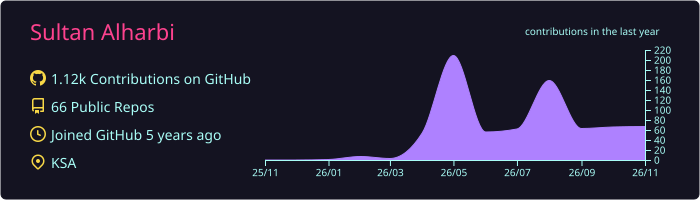
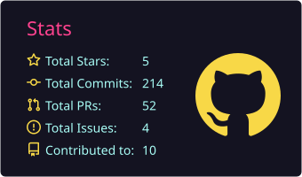
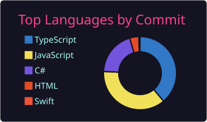
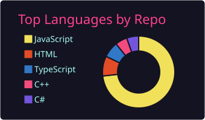
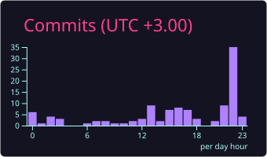

<div align="center">


<a href="https://sult4n.info">
  
</a>

<p>
  <a href="https://sult4n.info"></a>
  <a href="https://www.npmjs.com/package/blank-to-null"></a>
  
</p>

</div>

## 🧠 `whoami`

```ts
const sultan = {
  role: "Software Engineer",
  location: "KSA 🇸🇦",
  stack: {
    backend:  [".NET / C#", "FastAPI", "Laravel", "Node.js"],
    frontend: ["React", "Next.js", "TypeScript", "Tailwind"],
    mobile:   ["Swift / SwiftUI", "Flutter"],
    data:     ["MySQL", "PostgreSQL"],
    devops:   ["Docker", "GitHub Actions", "Linux"],
  },
  motto: "Root cause first. Smallest safe change. Ship it.",
  bio: MyBio || null,
};
```

## ⚡ Tech Arsenal

<div align="center">
  <br/>
  <br/>
  <br/>
  
</div>

## 🚀 Featured Work

| Project | What it does | Stack |
|---|---|---|
| [**blank-to-null**](https://github.com/gitsult4n/blank-to-null) · [npm](https://www.npmjs.com/package/blank-to-null) | Turns blank and undefined values into `null`, deeply, with zero dependencies |  |
| **all4all** 🔒 | iOS prayer companion: Qibla compass, prayer times & alarms, Gemini AI assistant (voice + camera), tasbih |  |
| [**bulk-data-processing-platform**](https://github.com/gitsult4n/bulk-data-processing-platform) · [UI](https://github.com/gitsult4n/bulk-data-processing-ui) | Bulk data processing backend with a dedicated web UI |   |

## 🤝 Open Source

<div align="center">


<a href="https://github.com/vercel/next.js/discussions/97479#discussioncomment-18064923"></a> <a href="https://github.com/anthropics/claude-code/issues?q=author%3Agitsult4n"></a>

<a href="https://github.com/deepseek-ai/deepseek-harness/discussions/4529#discussioncomment-18149686"></a> <a href="https://github.com/firecrawl/firecrawl/discussions/4436#discussioncomment-18182879"></a> <a href="https://github.com/ohmyzsh/ohmyzsh/discussions/13681#discussioncomment-18065323"></a> <a href="https://github.com/twbs/bootstrap/discussions/42841#discussioncomment-18065335"></a> <a href="https://github.com/AUTOMATIC1111/stable-diffusion-webui/discussions/17448#discussioncomment-18067103"></a> <a href="https://github.com/langgenius/dify/discussions/40930#discussioncomment-18065653"></a> <a href="https://github.com/langflow-ai/langflow/discussions/14608#discussioncomment-18065579"></a> <a href="https://github.com/Comfy-Org/ComfyUI/discussions/14307#discussioncomment-18065398"></a> <a href="https://github.com/excalidraw/excalidraw/discussions/11959#discussioncomment-18149321"></a> <a href="https://github.com/ggml-org/llama.cpp/discussions/27213#discussioncomment-18089752"></a> <a href="https://github.com/openai/codex/discussions/40740#discussioncomment-18182216"></a> <a href="https://github.com/rustdesk/rustdesk/discussions/15946#discussioncomment-18149323"></a> <a href="https://github.com/shadcn-ui/ui/discussions/11232#discussioncomment-18065680"></a> <a href="https://github.com/browser-use/browser-use/discussions/3940#discussioncomment-18182878"></a> <a href="https://github.com/immich-app/immich/discussions/30836#discussioncomment-18065598"></a> <a href="https://github.com/d3/d3/discussions/4024#discussioncomment-18067101"></a> <a href="https://github.com/axios/axios/discussions/5904#discussioncomment-18065156"></a> <a href="https://github.com/denoland/deno/discussions/20580#discussioncomment-18064977"></a> <a href="https://github.com/google-gemini/gemini-cli/discussions/29086#discussioncomment-18182181"></a> <a href="https://github.com/fastapi/fastapi/discussions/12151#discussioncomment-18065092"></a> <a href="https://github.com/neovim/neovim/discussions/40474#discussioncomment-18065413"></a> <a href="https://github.com/ant-design/ant-design/discussions/52778#discussioncomment-18178265"></a> <a href="https://github.com/tailwindlabs/tailwindcss/discussions/20355#discussioncomment-18065029"></a> <a href="https://github.com/NationalSecurityAgency/ghidra/discussions/9517#discussioncomment-18168529"></a> <a href="https://github.com/oven-sh/bun/discussions/26513#discussioncomment-18064990"></a> <a href="https://github.com/vllm-project/vllm/discussions/8287#discussioncomment-18149447"></a> <a href="https://github.com/Stirling-Tools/Stirling-PDF/discussions/7507#discussioncomment-18178270"></a> <a href="https://github.com/infiniflow/ragflow/discussions/14754#discussioncomment-18178271"></a> <a href="https://github.com/PaddlePaddle/PaddleOCR/discussions/18329#discussioncomment-18166666"></a> <a href="https://github.com/storybookjs/storybook/discussions/29128#discussioncomment-18065558"></a> <a href="https://github.com/mermaid-js/mermaid/discussions/8011#discussioncomment-18149324"></a> <a href="https://github.com/gin-gonic/gin/discussions/4406#discussioncomment-18178294"></a> <a href="https://github.com/sveltejs/svelte/discussions/10761#discussioncomment-18149325"></a> <a href="https://github.com/unclecode/crawl4ai/discussions/1921#discussioncomment-18182445"></a> <a href="https://github.com/vitejs/vite/discussions/22546#discussioncomment-18065673"></a> <a href="https://github.com/jesseduffield/lazydocker/discussions/624#discussioncomment-18182198"></a> <a href="https://github.com/netdata/netdata/discussions/21171#discussioncomment-18182155"></a> <a href="https://github.com/hoppscotch/hoppscotch/discussions/6045#discussioncomment-18178295"></a> <a href="https://github.com/coder/code-server/discussions/7502#discussioncomment-18182848"></a> <a href="https://github.com/unslothai/unsloth/discussions/9785#discussioncomment-18167099"></a> <a href="https://github.com/AppFlowy-IO/AppFlowy/discussions/490#discussioncomment-18182842"></a> <a href="https://github.com/redis/redis/discussions/15443#discussioncomment-18065103"></a> <a href="https://github.com/apache/superset/discussions/40082#discussioncomment-18065585"></a> <a href="https://github.com/Eugeny/tabby/discussions/11113#discussioncomment-18182484"></a> <a href="https://github.com/strapi/strapi/discussions/27241#discussioncomment-18065070"></a> <a href="https://github.com/moby/moby/discussions/52412#discussioncomment-18182864"></a> <a href="https://github.com/remotion-dev/remotion/discussions/5121#discussioncomment-18178296"></a> <a href="https://github.com/scikit-learn/scikit-learn/discussions/30073#discussioncomment-18182844"></a> <a href="https://github.com/prometheus/prometheus/discussions/16321#discussioncomment-18182836"></a> <a href="https://github.com/meta/docusaurus/discussions/11629#discussioncomment-18065169"></a> <a href="https://github.com/coollabsio/coolify/discussions/11343#discussioncomment-18067176"></a> <a href="https://github.com/usememos/memos/discussions/6239#discussioncomment-18178298"></a> <a href="https://github.com/ghostty-org/ghostty/discussions/14032#discussioncomment-18166861"></a> <a href="https://github.com/socketio/socket.io/discussions/5476#discussioncomment-18067102"></a> <a href="https://github.com/penpot/penpot/discussions/9047#discussioncomment-18182460"></a> <a href="https://github.com/pocketbase/pocketbase/discussions/7490#discussioncomment-18182097"></a> <a href="https://github.com/nuxt/nuxt/discussions/36098#discussioncomment-18065613"></a> <a href="https://github.com/jellyfin/jellyfin/discussions/16350#discussioncomment-18067071"></a> <a href="https://github.com/pmndrs/zustand/discussions/3413#discussioncomment-18182837"></a> <a href="https://github.com/Textualize/rich/discussions/3801#discussioncomment-18182866"></a> <a href="https://github.com/vuejs/core/discussions/14028#discussioncomment-18065008"></a> <a href="https://github.com/mozilla/pdf.js/discussions/20315#discussioncomment-18182828"></a> <a href="https://github.com/expo/expo/discussions/44787#discussioncomment-18065633"></a> <a href="https://github.com/etcd-io/etcd/discussions/22206#discussioncomment-18182206"></a> <a href="https://github.com/prettier/prettier/discussions/16452#discussioncomment-18182865"></a> <a href="https://github.com/ClickHouse/ClickHouse/discussions/94773#discussioncomment-18069097"></a> <a href="https://github.com/mudler/LocalAI/discussions/11727#discussioncomment-18168469"></a> <a href="https://github.com/omacom/omarchy/discussions/8415#discussioncomment-18166862"></a> <a href="https://github.com/grpc/grpc/discussions/43097#discussioncomment-18067197"></a> <a href="https://github.com/Kong/kong/discussions/14865#discussioncomment-18069085"></a> <a href="https://github.com/trpc/trpc/discussions/4579#discussioncomment-18065048"></a> <a href="https://github.com/hyprwm/Hyprland/discussions/16011#discussioncomment-18168368"></a> <a href="https://github.com/umami-software/umami/discussions/4439#discussioncomment-18067069"></a> <a href="https://github.com/aquasecurity/trivy/discussions/11099#discussioncomment-18032023"></a> <a href="https://github.com/keycloak/keycloak/discussions/51746#discussioncomment-18067146"></a> <a href="https://github.com/pnpm/pnpm/discussions/13713#discussioncomment-18065057"></a> <a href="https://github.com/solidjs/solid/discussions/3051#discussioncomment-18168455"></a> <a href="https://github.com/drizzle-team/drizzle-orm/discussions/5891#discussioncomment-18065664"></a> <a href="https://github.com/jdx/mise/discussions/9438#discussioncomment-18166661"></a> <a href="https://github.com/laravel/framework/discussions/61210#discussioncomment-18065123"></a> <a href="https://github.com/NginxProxyManager/nginx-proxy-manager/discussions/3978#discussioncomment-18067145"></a> <a href="https://github.com/tokio-rs/tokio/discussions/8356#discussioncomment-18048724"></a> <a href="https://github.com/honojs/hono/discussions/4639#discussioncomment-18065083"></a> <a href="https://github.com/emilk/egui/discussions/8319#discussioncomment-18168419"></a> <a href="https://github.com/AvaloniaUI/Avalonia/discussions/21990#discussioncomment-18032036"></a> <a href="https://github.com/Lightning-AI/pytorch-lightning/discussions/21569#discussioncomment-18069091"></a> <a href="https://github.com/symfony/symfony/discussions/64861#discussioncomment-18167218"></a> <a href="https://github.com/nautechsystems/nautilus_trader/discussions/4870#discussioncomment-18166665"></a> <a href="https://github.com/layui/layui/discussions/3129#discussioncomment-18167067"></a> <a href="https://github.com/goharbor/harbor/discussions/23605#discussioncomment-18069093"></a> <a href="https://github.com/pydantic/pydantic/discussions/13574#discussioncomment-18067070"></a> <a href="https://github.com/requarks/wiki/discussions/8074#discussioncomment-18167010"></a> <a href="https://github.com/goauthentik/authentik/discussions/24175#discussioncomment-18067227"></a> <a href="https://github.com/argoproj/argo-cd/discussions/29157#discussioncomment-18067067"></a> <a href="https://github.com/livewire/livewire/discussions/10445#discussioncomment-18031126"></a> <a href="https://github.com/pqrs-org/Karabiner-Elements/discussions/4526#discussioncomment-18167131"></a> <a href="https://github.com/renovatebot/renovate/discussions/45402#discussioncomment-18123042"></a> <a href="https://github.com/nats-io/nats-server/discussions/8444#discussioncomment-18048723"></a> <a href="https://github.com/ppy/osu/discussions/38561#discussioncomment-18168520"></a> <a href="https://github.com/sumatrapdfreader/sumatrapdf/discussions/6029#discussioncomment-18123047"></a> <a href="https://github.com/dagster-io/dagster/discussions/30725#discussioncomment-18069098"></a> <a href="https://github.com/zauberzeug/nicegui/discussions/6306#discussioncomment-18123046"></a> <a href="https://github.com/v2rayA/v2rayA/discussions/1944#discussioncomment-18123041"></a> <a href="https://github.com/PHPOffice/PhpSpreadsheet/discussions/4963#discussioncomment-18053256"></a> <a href="https://github.com/borgbackup/borg/discussions/10215#discussioncomment-18166664"></a> <a href="https://github.com/trinodb/trino/discussions/30684#discussioncomment-18168589"></a> <a href="https://github.com/fluxcd/flux2/discussions/6039#discussioncomment-18053326"></a> <a href="https://github.com/mackron/miniaudio/discussions/1147#discussioncomment-18031259"></a> <a href="https://github.com/google/perfetto/discussions/7112#discussioncomment-18053336"></a> <a href="https://github.com/alexjustesen/speedtest-tracker/discussions/2863#discussioncomment-18031169"></a> <a href="https://github.com/home-assistant/frontend/discussions/53720#discussioncomment-18182519"></a> <a href="https://github.com/LycheeOrg/Lychee/discussions/4610#discussioncomment-18031157"></a> <a href="https://github.com/cvc5/cvc5/discussions/12839#discussioncomment-18053320"></a> <a href="https://github.com/sulu/sulu/discussions/8925#discussioncomment-18048722"></a> <a href="https://github.com/tt-rss/tt-rss/discussions/420#discussioncomment-18031131"></a> <a href="https://github.com/akeeba/panopticon/discussions/1033#discussioncomment-18031334"></a>

<sub>Sorted by repo stars · hover a logo for details</sub>

</div>

## 📊 Stats

<div align="center">
  
  <br/>
  
  
  <br/>
  
  
  <br/>
  
</div>

## 🐍 Eating My Contributions

<div align="center">
  <picture>
    <source media="(prefers-color-scheme: dark)" srcset="https://raw.githubusercontent.com/gitsult4n/gitsult4n/output/github-snake-dark.svg" />
    <source media="(prefers-color-scheme: light)" srcset="https://raw.githubusercontent.com/gitsult4n/gitsult4n/output/github-snake.svg" />
    
  </picture>
</div>


