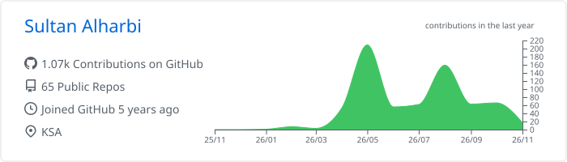
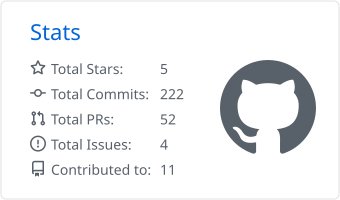
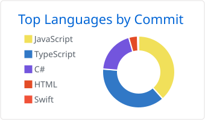

## Hi, I'm Sultan 👋

Software Engineer based in KSA 🇸🇦. I build production backends, web apps, and native mobile apps — focused on clean architecture, root-cause debugging, and shipping small, safe changes.

### Tech Stack

| Area | Tools |
|---|---|
| **Backend** |        |
| **Frontend** |     |
| **Mobile** |    |
| **Data & DevOps** |      |

### Featured Work

| Project | Description | Stack |
|---|---|---|
| [blank-to-null](https://github.com/gitsult4n/blank-to-null) | Turns blank and undefined values into `null`, deeply, with zero dependencies. Published on [npm](https://www.npmjs.com/package/blank-to-null). | TypeScript |
| all4all *(private)* | iOS prayer companion: Qibla compass, prayer times & alarms, Gemini AI assistant (voice + camera), tasbih. | Swift |
| [bulk-data-processing-platform](https://github.com/gitsult4n/bulk-data-processing-platform) | Bulk data processing backend with a dedicated [web UI](https://github.com/gitsult4n/bulk-data-processing-ui). | C#, TypeScript |

### GitHub Stats

<picture>
  <source media="(prefers-color-scheme: dark)" srcset="./profile-summary-card-output/github_dark/0-profile-details.svg" />
  
</picture>

<picture>
  <source media="(prefers-color-scheme: dark)" srcset="./profile-summary-card-output/github_dark/3-stats.svg" />
  
</picture>
<picture>
  <source media="(prefers-color-scheme: dark)" srcset="./profile-summary-card-output/github_dark/2-most-commit-language.svg" />
  
</picture>
